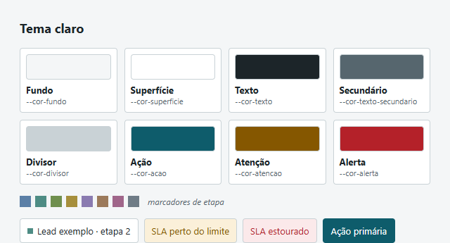
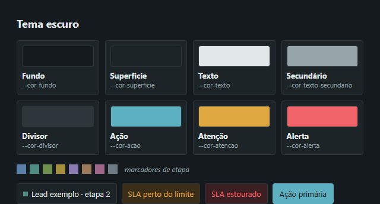

# Base CRM

CRM operacional para **registro, distribuição e acompanhamento de leads**, feito para equipes que atendem muito lead pelo WhatsApp. É um webapp (o produto) com uma **extensão de navegador** que mostra o contexto do lead ao lado da conversa no WhatsApp Web.

> **Status (setembro/2026):** os documentos de decisão estão **concluídos e aprovados** (Etapa 0), e a **fundação do monorepo** está em andamento (Etapa 1). Ainda não há telas: as imagens abaixo mostram os tokens de design aprovados, que já estão implementados em `packages/ui`.

| Tema claro | Tema escuro |
|---|---|
|  |  |

---

## O problema

Equipes comerciais de alto volume (muito lead frio, ciclo longo, atendimento quase todo pelo WhatsApp) costumam operar entre planilhas, grupos de mensagem e CRMs genéricos. Nesse cenário:

- **não se sabe quem está com cada lead**, nem há quanto tempo ele está parado;
- a **distribuição entre operadores** é manual e injusta;
- o atendimento acontece no WhatsApp, **fora do CRM**, e o histórico se perde;
- os CRMs prontos ou são caros e genéricos demais, ou nascem amarrados a um nicho e não servem a outro mercado.

## A solução

Um CRM **neutro de nicho**: nasce da rotina de corretagem, mas o domínio fala só em *Lead, Operador, Coordenador, Gestor, Fila, Etapa, Distribuição e Conversa*. O que é específico de cada mercado entra por **campos customizados** da organização. O mesmo produto serve a uma imobiliária, uma escola ou uma clínica sem refatoração.

**Escopo inicial**
- Kanban de leads com pipelines e etapas configuráveis pelo Gestor, SLA por etapa e motivo obrigatório onde fizer sentido.
- Card lateral com resumo, anotações com menção e histórico completo (linha do tempo de eventos).
- Botão de contato rápido: abre o WhatsApp Web no desktop e o app no celular, com template preenchido.
- Papéis e permissões (Operador, Coordenador, Gestor) e auditoria de toda escrita.
- PWA responsivo.
- **Extensão** com barra lateral no `web.whatsapp.com`: mostra o lead da conversa aberta, permite mudar etapa e anotar. Não lê nem envia mensagens.
- Integrações **pré-estruturadas** (WhatsApp por API e CV CRM) em modo simulação, ativáveis por configuração.

**Fases seguintes:** filas e motor de distribuição (4 estratégias), importação de planilha com desfazer, painéis por operador e fila, e depois as integrações reais.

---

## Stack

| Camada | Escolha |
|---|---|
| Webapp | **Next.js 16.3** (App Router) · React 19 · TypeScript strict |
| UI | Tailwind CSS v4 · shadcn/ui re-estilizado · dnd-kit (Kanban) · TanStack Table + Virtual · Tiptap · Recharts · cmdk |
| API | **tRPC** + TanStack Query · Zod · React Hook Form · `nuqs` (filtros na URL) |
| Hospedagem | **Cloudflare Workers** via `@opennextjs/cloudflare` · R2 (arquivos) · Queues, Workflows e Cron (jobs, a partir da Fase 3) |
| Banco e auth | **Supabase**: Postgres com RLS, Auth (MFA para o Gestor) e Realtime |
| Acesso a dados | **Drizzle ORM** via Cloudflare Hyperdrive |
| Extensão | **WXT** (Vite + React) · Manifest V3 · Chrome Side Panel API |
| Monorepo | **pnpm** workspaces + **Turborepo** |
| Qualidade | Vitest · Playwright · ESLint · Prettier · lint de vocabulário de nicho |
| Observabilidade | Workers Logs (JSON) + Sentry |

```
apps/                 (criados nas próximas etapas)
  web/                Next.js → Cloudflare Workers
  extension/          WXT → barra lateral do WhatsApp Web
packages/
  config/             brand.ts, ESLint, tsconfig, lista de vocabulário proibido
  core/               policy engine, regras de domínio, motor de distribuição (sem I/O)
  db/                 schema Drizzle, migrations, policies RLS, seed
  integrations/       MessagingProvider, ExternalCrmAdapter, adapters mock e stub
  ui/                 tokens de design e componentes (web + extensão)
supabase/             config local, hooks de auth, seeds
```

## Como rodar

Requer Node ≥ 22.11 (a versão do projeto está em `.node-version`) e pnpm.

```bash
pnpm install
pnpm check          # ferramentas + lint + lint de vocabulário + typecheck + testes
```

Na máquina de desenvolvimento, uma política de grupo bloqueia arquivos `.cmd`. Por isso os scripts padrão usam `pnpm -r` em vez do Turborepo; os scripts `turbo:*` rodam no CI (Linux). Detalhes em [`docs/ambiente-de-desenvolvimento.md`](docs/ambiente-de-desenvolvimento.md).

---

## Decisões técnicas

As decisões estão registradas como ADRs em [`ARCHITECTURE.md`](ARCHITECTURE.md). As principais:

### 1. Webapp é o produto; a extensão é complemento (ADR-01, ADR-13)
Extensão não roda no celular, não serve para gestão em tela cheia e depende do DOM do WhatsApp. Se ela quebrar, o produto continua funcionando. A interface da extensão fica no **Side Panel** do Chrome, fora do DOM do WhatsApp. O content script só identifica a conversa ativa, e os seletores chegam como **configuração remota** (dado, não código).

### 2. 100% nuvem, sem VPS (ADR-02, ADR-12)
Cloudflare Workers + Supabase: ninguém precisa administrar servidor. O que a especificação original pedia em Redis + BullMQ virou **Queues + Workflows + Cron Triggers**. A saída de emergência está prevista: o app e o `packages/core` rodam em Node sem alteração.

### 3. Autorização em três camadas (ADR-05, ADR-06)
1. **Policy engine** `can(membro, ação, alvo)` em `packages/core`, usado no tRPC **e** na UI. `if (role === 'gestor')` espalhado pelo código é proibido.
2. **RLS no Postgres**: cada request roda numa transação com `set local role` e as claims do JWT, então o banco barra o acesso mesmo se a API tiver bug.
3. **Triggers de invariantes**: `lead_events` só aceita inserção, a etapa só muda pelo dono ou pelo Gestor e o `organization_id` é imutável.

Assim dá para **provar** o critério "operador não acessa lead alheio por nenhuma rota".

### 4. Tabelas fora da Data API do Supabase (ADR-04)
O schema `app` não é exposto pelo PostgREST: todo acesso a dados passa pelo tRPC. O `supabase-js` no cliente serve só para Auth e Realtime, sem uma segunda API que contorne as regras.

### 5. Realtime disparado pelo banco (ADR-08)
Um trigger em `lead_events` publica em **canais privados** do Supabase Realtime, com tópicos separados para supervisão, para cada membro e para configuração. O payload é mínimo. O replay usa `event_id` UUID v7 (ordenável). A meta é a mudança chegar à tela de todos em menos de 1 s, sem servidor de WebSocket próprio.

### 6. Evento e auditoria na mesma transação (ADR-09)
Cada mutação valida com `can()`, altera a entidade e grava em `lead_events` de uma vez. Um trigger genérico grava `audit_logs` com o diff em **100% das escritas**. Na UI, o update é otimista com rollback.

### 7. Integrações por contrato, sem inventar API (ADR-11)
As interfaces `MessagingProvider` e `ExternalCrmAdapter` têm um adapter *mock* funcional e esqueletos para Meta Cloud API, Evolution e CV CRM. Trocar de provedor é **configuração**. Credenciais são cifradas com AES-256-GCM, com versão da chave para rotação.

### 8. Marca centralizada e neutralidade como regra de CI (ADR-14)
O nome do produto vive só em `packages/config/brand.ts` e troca em um commit. O script `pnpm lint:vocab` **falha o build** se aparecer vocabulário de nicho em código, schema, estilos ou textos de interface.

### 9. Design "mesa de despacho" ([`DESIGN.md`](DESIGN.md))
A interface é lida pela visão periférica: o normal é silencioso, e só o que exige ação ganha cor. A única cor saturada é a escala de urgência (Atenção/Alerta, ligada ao SLA). As etapas são marcadas com tons dessaturados de 8 px, a densidade é alta e o movimento só confirma ações.

### Divergências da especificação original

| Especificação | Adotado | Motivo |
|---|---|---|
| Next.js 15 | Next.js 16.3 | Linha estável atual, suporte do OpenNext |
| Better Auth / Auth.js | Supabase Auth | Integração direta com RLS, MFA nativo, sessão compartilhada com a extensão |
| Socket.io / Pusher | Supabase Realtime | Sem servidor de WebSocket próprio |
| Redis + BullMQ | Queues + Workflows + Cron | Sem processo contínuo |
| Docker + Caddy | Workers + Supabase | Sem VPS |
| Extensão na Fase 4 | Extensão na Fase 2 | Prioridade do produto |

---

## Documentos

| Documento | Conteúdo |
|---|---|
| [`PLANO.md`](PLANO.md) | Decisões consolidadas, escopo, roadmap e critérios de aceite por fase |
| [`ARCHITECTURE.md`](ARCHITECTURE.md) | ADRs, ambientes, observabilidade, segurança e riscos |
| [`SCHEMA.md`](SCHEMA.md) | Modelo de dados, índices, constraints e RLS |
| [`DESIGN.md`](DESIGN.md) | Conceito visual, paleta, tipografia, componentes e tokens |
| [`EXTENSION.md`](EXTENSION.md) | Detecção da conversa, permissões, autenticação e riscos da extensão |
| [`prompt-crm-leads.md`](prompt-crm-leads.md) | Especificação original |
